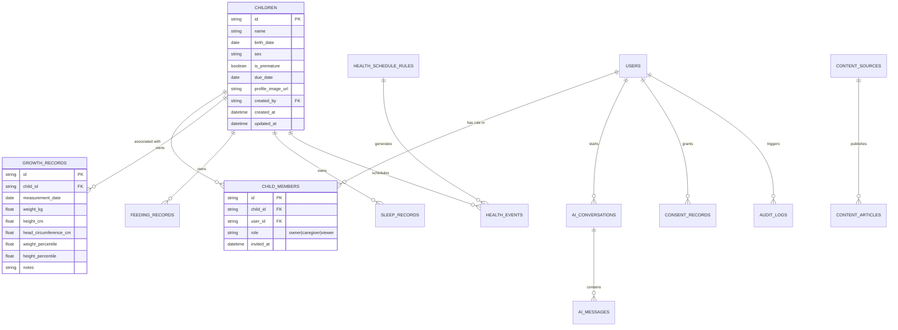
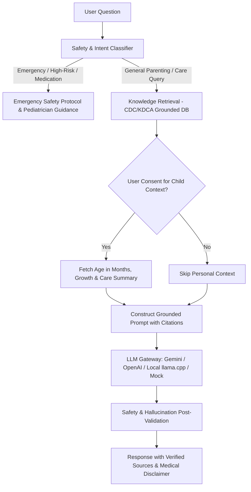

# HD²LAB BabyCare — Architecture Review

**Document Version:** 1.0.0  
**Date:** 2026-11-07  
**Author:** Google Antigravity Agent  
**Scope:** Existing Infrastructure Audit, Target System Architecture & Interface Baseline

---

## 1. Executive Summary

This architecture review establishes the technical baseline for **HD²LAB BabyCare**, an integrated, production-grade parenting web platform combining baby profiles, physical growth tracking, daily care (feeding/sleep) tracking, health & vaccination calendar, authoritative parenting knowledge, and the personalized **HyangDani Baby AI** assistant.

In accordance with HD2Lab Master Development Principles (1.1 Existing Infrastructure First):
1. **Repository & Infrastructure Audit**: We audited the workspace parent (`/Users/jaehyukshim/AGWS`), sibling repositories (`Web-HQ`, `AGPilot0001`, `AGPilot0002`, `AGPilot0003`), and deployment references (`hd2lab.duckdns.org`).
2. **Current State Findings**:
   - `Web-HQ` serves as the primary static portal entry point (`https://hyangdan2.github.io/`, `hd2lab.duckdns.org`) with HD2Lab brand tokens (Dark Slate background `#101110`, Accent Orange `#ff824f`, Skew Mark `-23deg`).
   - `AGPilot0002` (Todo Master) establishes the PWA single-page application standard with clean local-first storage, accessible ARIA modal systems, and responsive desktop/mobile viewports.
   - `AGPilot0003` (CoverFilm CAD) establishes the modern Python FastAPI backend service pattern with Pydantic schemas, typed REST API contracts, and isolated `.venv` dependencies.
   - The remote domain `hd2lab.duckdns.org` is a Raspberry Pi/Linux host behind Nginx reverse proxy and systemd service units. Remote Google OAuth credentials are not exposed in public repositories.
3. **Authentication & Integration Adapter**:
   - To avoid duplicate authentication code while preserving standalone development and strict privacy, an **Auth Adapter Layer** is specified:
     - `HD2LabAuthAdapter`: Connects to session cookies or Google OAuth bearer tokens forwarded by the host reverse proxy.
     - `LocalDevAuthAdapter`: Provides secure, isolated local multi-user testing with zero external dependencies.
4. **Target Resource Boundaries**:
   - Single modular FastAPI service backend to conserve memory on resource-constrained host environments (e.g., Raspberry Pi).
   - SQLite for isolated local test/dev; PostgreSQL driver support via SQLAlchemy 2.0 async/sync engine for production.
   - React + Vite + Tailwind CSS + TanStack Query + PWA for the client web application with strict responsive layouts.

---

## 2. Infrastructure & Repository Audit

| System Area | Existing Observed Baseline | HD²LAB BabyCare Design & Adoption |
| :--- | :--- | :--- |
| **Monorepo / Workspace** | Sibling projects under `AGWS/` (`Web-HQ`, `AGPilot0001`~`0003`). `AGPilot0004` is dedicated to BabyCare. | Clean modular structure under `services/babycare/` (Frontend & Backend in one repository). |
| **Backend Framework** | Python 3.13 + FastAPI + Pydantic v2 in `AGPilot0003`. | FastAPI + Pydantic v2 + SQLAlchemy 2.0 + Alembic migrations. |
| **Frontend Framework** | Static HTML/ES modules (`Web-HQ`, `AGPilot0002`), Vite + TS (`AGPilot0001`). | React 18/19 + TypeScript + Vite + Tailwind CSS + Lucide Icons + Recharts. |
| **Design System** | HD2Lab dark theme (`#101110`, `#ff824f`, skew mark). | HD2Lab BabyCare Dual Token System: Preserves HD2Lab modern precision while adopting warm, friendly parenting tokens (Soft Blue `#3B82F6`, Mint `#10B981`, Lavender `#8B5CF6`, Warm Off-White `#F8FAFC`, Dark Slate `#0F172A`). |
| **Authentication** | External Google OAuth via Nginx proxy headers (`X-User-Email`, `X-User-Id`, `Authorization`). | Adapter pattern: `AuthAdapter` protocol verifying Bearer JWT / Session headers, with Mock/Local provider for local CI/CD tests. |
| **Reverse Proxy** | Nginx reverse proxy targeting `https://hd2lab.duckdns.org/babycare/` and `/api/babycare/v1/`. | Path-prefix friendly routing (`Vite base: /babycare/`, API prefix: `/api/babycare/v1`). |
| **Process Management** | Linux `systemd` daemon for Python backend service. | Systemd unit template provided in `deploy/babycare.service`. |
| **Memory / CPU Footprint** | Raspberry Pi ARM64 constraint (avoid heavyweight microservices or redundant node servers). | Monolithic single-process FastAPI with in-memory/SQLite cache, lazy AI model dispatch, and optimized static asset bundle. |

---

## 3. Database Architecture & Multi-Child Data Isolation

### 3.1 Schema Relationship Map

### 3.2 Security & Data Isolation
1. **Object-Level Access Control (RBAC/ABAC)**:
   - Every API request involving `/children/{id}/...` verifies `CHILD_MEMBERS` membership before executing query.
   - Non-members receive `404 Not Found` or `403 Forbidden`.
   - Role hierarchy:
     - `owner`: full CRUD, invite/revoke family members, manage consent, export/delete data.
     - `caregiver`: add/edit/delete growth, feeding, sleep, and health event records.
     - `viewer`: read-only access to child records and reports.
2. **Audit Logging & Privacy Safeguards**:
   - `CONSENT_RECORDS` stores timestamped user consent for: (1) Baby profile storage, (2) AI context usage.
   - Sensitive personal health information is strictly scrubbed from application logs.
   - Child birth dates and medical notes are never transmitted to third-party LLMs without active user consent flag on each chat request.

---

## 4. AI Assistant Architecture (HyangDani Baby AI)

---

## 5. Technology Stack Selection & Constraints

- **Language / Runtime**: Python 3.13 (Backend), Node 22 (Frontend build).
- **Backend**: FastAPI 0.115+, Pydantic v2, SQLAlchemy 2.0, Alembic, SQLite/PostgreSQL.
- **Frontend**: React 18/19, TypeScript, Vite, Tailwind CSS, Lucide React, Recharts, TanStack Query.
- **Growth Standards**: 2017 Korean National Growth Charts for Children and Adolescents (KDCA / Korean Pediatric Society LMS parameters) + WHO Child Growth Standards fallback.
- **Deployment**: Single-process service listening on `127.0.0.1:8004`, reverse-proxied via Nginx at `/babycare/` and `/api/babycare/v1/`.
