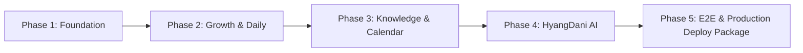

# HD²LAB BabyCare — Phased Implementation Plan

**Version:** 1.0.0  
**Target:** Production-Ready Responsive Web App + PWA + FastAPI Backend  
**Development Method:** Autonomous Phased Implementation with QA Gates

---

## 1. Development Phases & Work Breakdown

### Phase 1: Foundation (Architecture, Auth, Child Profile, Dashboard UI)
- **Task 1**: Project inspection & architecture baseline (`docs/architecture-review.md`, `docs/implementation-plan.md`).
- **Task 2**: Project structure setup:
  - `services/babycare/backend`: FastAPI application, Pydantic schemas, SQLAlchemy models, database engine, migrations configuration.
  - `services/babycare/frontend`: Vite + React + TypeScript + Tailwind CSS + Lucide + Router.
- **Task 3**: Authentication & User Identity Adapter:
  - `AuthAdapter` interface supporting Bearer token, Cookie session, and LocalDev multi-user mock.
  - User and Child association model (`ChildMember` with Owner/Caregiver/Viewer roles).
- **Task 4**: Baby Profile CRUD & Isolation:
  - Child creation, update, deletion, profile photo upload with validation (JPEG/PNG/WebP, max 5MB).
  - Corrected age calculator for premature birth (gestational weeks/due date logic).
- **Task 5**: Responsive Dashboard Core:
  - Desktop 3-panel / left sidebar navigation with HD2Lab BabyCare design tokens.
  - Mobile bottom navigation (Home, Growth, Knowledge, AI, More).
  - Baby Switcher for multi-child families with real-time state synchronization.
- **QA Gate 1**: Backend API unit tests, child CRUD & isolation tests, frontend component rendering & responsive viewport checks.

---

### Phase 2: Growth & Daily Care Tracking
- **Task 6**: Growth Tracker & LMS Percentile Engine:
  - Growth record model (`growth_records`: date, weight, height, head circumference, notes).
  - Official 2017 Korean CDC (질병관리청) Child Growth Chart LMS tables and percentile calculation engine:
    $$Z = \frac{(X/M)^L - 1}{L \cdot S} \quad (L \neq 0), \quad Z = \frac{\ln(X/M)}{S} \quad (L = 0)$$
    $$\text{Percentile} = \Phi(Z) \times 100$$
  - Recharts growth curves (3rd, 50th, 97th percentiles) with user measurement plots.
- **Task 7**: Feeding Tracker:
  - Feeding model (`feeding_records`: breastfeeding left/right min, formula mL, expressed milk mL, start/end time, notes).
  - Daily feeding aggregation, total volume, frequency calculation, chronological list.
- **Task 8**: Sleep Tracker:
  - Sleep model (`sleep_records`: start_time, end_time, duration_min, is_nap, notes).
  - Real-time active sleep timer ("수면 중"), midnight crossing handler, daily/weekly sleep duration charts.
- **Task 9**: Growth & Daily Care Analytics Dashboard:
  - Summary cards (Today's feeding total, last sleep duration, next expected care).
  - Strict prohibition against automatic diagnostic judgments.
- **QA Gate 2**: Percentile formula accuracy tests against official Korean CDC reference values, midnight sleep duration calculation tests, feeding aggregation tests, multi-child isolation tests.

---

### Phase 3: Parenting Knowledge & Health Calendar
- **Task 10**: Parenting Knowledge Library:
  - Article model (`content_articles`, `content_sources`: title, category, age_range, content, source_url, license, review_status, version).
  - 8 core categories: Newborn Care, Feeding, Sleep, Development, Health, Safety, Weaning, Parenting Tips.
  - Seeded with authoritative, public-license pediatric guidance from Korean CDC / Ministry of Health and Welfare.
  - Search by keyword, category, and baby month age.
- **Task 11**: Health & Vaccination Calendar:
  - Rule-driven national immunization schedule engine (BCG, HepB, DTaP, Polio, Hib, PCV, MMR, Varicella, HepA, Influenza, Japanese Encephalitis).
  - National Infant Health Checkup (영유아 건강검진 1차~8차) schedule engine based on birth date.
  - Health event status: `scheduled`, `completed`, `overdue`. Manual completion tracking with self-reported badge.
- **QA Gate 3**: Knowledge search & age filtering tests, vaccination schedule calculation tests for diverse birth dates, rule modification isolation tests.

---

### Phase 4: HyangDani Baby AI Assistant
- **Task 12**: AI Gateway Interface:
  - Provider-agnostic gateway (`LLMGateway`: supports Google Gemini, OpenAI, Local llama.cpp, Mock Test Engine).
- **Task 13**: Knowledge RAG Pipeline:
  - 8-step pipeline: Question Classification -> Safety Screening -> Knowledge Retrieval -> Child Context Retrieval (consent-gated) -> Prompt Assembly -> LLM Generation -> Output Safety Validation -> Grounded Response with Source Citations.
- **Task 14**: Child Context & Privacy Consent:
  - Explicit consent check before passing child age, growth trend, or care summaries to the AI pipeline.
  - Zero-write policy: AI cannot directly mutate or insert child database records.
- **Task 15**: Safety Guardrails:
  - Emergency keyword & symptom classifier (cyanosis, convulsion, high fever under 3 months, respiratory distress, severe dehydration, poisoning).
  - Immediate red-alert emergency advice and 119/emergency room contact instructions.
  - Non-medical disclaimer and mandatory pediatrician consultation notice.
- **Task 16**: AI Chat Interface:
  - Clean conversational UI with suggested prompts, verified source links, child context toggle, and report button.
- **QA Gate 4**: Safety screening QA suite (emergency symptom prompts, medication dosage rejection, hallucination prevention, consent enforcement).

---

### Phase 5: Integration, E2E QA & Production Deployment Package
- **Task 17**: End-to-end integration across all modules.
- **Task 18**: Production deployment assets:
  - Nginx reverse proxy configuration (`deploy/nginx-babycare.conf`).
  - Systemd unit file (`deploy/babycare.service`).
  - Environment templates (`.env.production.example`).
  - Database backup/restore scripts (`deploy/backup.sh`, `deploy/restore.sh`).
- **Task 19**: Master verification & release report.
